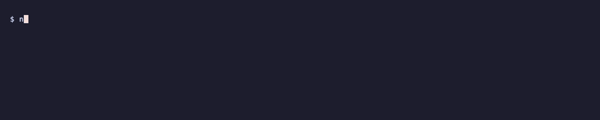

<!-- SPDX-License-Identifier: Apache-2.0 OR MIT -->

<p align="center">
  
</p>

<h1 align="center">jspassgen-cli</h1>

<p align="center">
  The jspassgen command line: it generates passwords on your machine from the platform CSPRNG, with all generation done by the @sebastienrousseau/jspassgen library.
</p>

<p align="center">
  <a href="https://github.com/sebastienrousseau/jspassgen-cli/actions"></a>
  <a href="https://www.npmjs.com/package/@sebastienrousseau/jspassgen-cli"></a>
  <a href="https://github.com/sebastienrousseau/jspassgen-cli/blob/main/DEVELOPMENT.md"></a>
  <a href="https://scorecard.dev/viewer/?uri=github.com/sebastienrousseau/jspassgen-cli"></a>
  <a href="LICENSE-APACHE"></a>
  <a href="#requirements"></a>
</p>

<p align="center">
  
</p>

---

## Contents

**Getting started**

- [Install](#install): global install, `npx`, or a checkout
- [Requirements](#requirements): Node.js floor, platforms, dependencies
- [Quick Start](#quick-start): print the version and generate a password

**The jspassgen ecosystem**

- [The jspassgen ecosystem](#the-jspassgen-ecosystem): the core library, its tools, native SDKs and site

**Library reference**

- [Capabilities at a glance](#capabilities-at-a-glance): what the bin does today, and what it does not yet
- [Ecosystem comparison](#ecosystem-comparison): this bin against the one inside jspassgen
- [Benchmarks](#benchmarks): none, and why
- [Features](#features): the current surface
- [Configuration](#configuration): the `generate` options
- [Examples](#examples): command lines

**Operational**

- [When not to use jspassgen-cli](#when-not-to-use-jspassgen-cli): limitations
- [Development](#development): make targets and CI
- [Security](#security): randomness, network and data handling
- [Documentation](#documentation): all reference docs
- [Stability guarantees](#stability-guarantees): version axis and toolchain floor
- [License](#license)

---

## Install

### As a JavaScript library

This package is a command line, not a library: it exports no API, and
programs should depend on
[`@sebastienrousseau/jspassgen`](https://www.npmjs.com/package/@sebastienrousseau/jspassgen)
directly.

### As a command line

Install the `jspassgen` command globally, or run it once without
installing:

```bash
npm install -g @sebastienrousseau/jspassgen-cli
npx @sebastienrousseau/jspassgen-cli generate
```

`@sebastienrousseau/jspassgen` also installs a bin named `jspassgen`;
install only one of the two globally.

Run the bin from a checkout:

```bash
git clone https://github.com/sebastienrousseau/jspassgen-cli.git
cd jspassgen-cli
npm ci
node bin/jspassgen.js --version
```

---

## Requirements

- Node.js 22.12 or newer (`engines` in `package.json`), the floor that
  `commander` 15 declares.
- CI runs the tests on Node.js 22 and 24 on Ubuntu 24.04. The code is
  plain ESM JavaScript with no native modules.
- Run-time dependencies: `@sebastienrousseau/jspassgen`, pinned to
  exactly 0.0.22, the suite version, and `commander`.

---

## Quick Start

```bash
jspassgen --version
jspassgen generate
jspassgen generate --length 12 --iteration 3 --separator .
```

`--version` prints this package's version. `generate` prints one strong
password: `--iteration` chunks of `--length` base64 characters (16 and 4
by default), joined by `--separator` (`-` by default). The characters
come from the library's strong generator over Node.js `crypto`; the CLI
only parses arguments and prints the result. An option the library
rejects (for example `--length 0`) prints the library's message on
standard error and exits with status 1.

---

## The jspassgen ecosystem

jspassgen is one core library and the tools, SDKs and site around it.
Every member is listed in
[`docs/ecosystem.json`](https://github.com/sebastienrousseau/jspassgen/blob/main/docs/ecosystem.json)
and, from the suite's first lockstep release, every member ships the same
version ([ADR 0001](https://github.com/sebastienrousseau/jspassgen/blob/main/docs/adr/0001-ecosystem-lockstep.md)).
The JavaScript tools depend on the core and add no generation logic of
their own; each SDK is a native port that is checked against the core's
conformance kit as its generators land.

| Component                                                                           | Purpose                                                                                               | Use case                                        |
| :---------------------------------------------------------------------------------- | :---------------------------------------------------------------------------------------------------- | :---------------------------------------------- |
| [`jspassgen`](https://github.com/sebastienrousseau/jspassgen)                       | Password and passphrase core, Node.js library, CLI, web UI and workers; source of the conformance kit | Programs that generate secrets                  |
| **`jspassgen-cli`**                                                                 | Command-line generator built on the core                                                              | Passwords in a terminal or a script             |
| [`jspassgen-mcp`](https://github.com/sebastienrousseau/jspassgen-mcp)               | Local stdio MCP server                                                                                | AI agents that need a generated secret          |
| [`jspassgen-lsp`](https://github.com/sebastienrousseau/jspassgen-lsp)               | Language server for weak literal secrets                                                              | Editors checking configuration and `.env` files |
| [`jspassgen-sdk-python`](https://github.com/sebastienrousseau/jspassgen-sdk-python) | Native port on the `secrets` module                                                                   | Python programs                                 |
| [`jspassgen-sdk-rust`](https://github.com/sebastienrousseau/jspassgen-sdk-rust)     | Native port on the OS CSPRNG                                                                          | Rust programs                                   |
| [`jspassgen-sdk-java`](https://github.com/sebastienrousseau/jspassgen-sdk-java)     | Native port on `SecureRandom`                                                                         | JVM programs                                    |
| [`jspassgen-sdk-dotnet`](https://github.com/sebastienrousseau/jspassgen-sdk-dotnet) | Native port on `RandomNumberGenerator`                                                                | .NET programs                                   |
| [`jspassgen-sdk-cpp`](https://github.com/sebastienrousseau/jspassgen-sdk-cpp)       | Native C++17 port on the OS CSPRNG                                                                    | C++ programs                                    |
| [`jspassgen.github.io`](https://github.com/sebastienrousseau/jspassgen.github.io)   | Source of [jspassgen.com](https://jspassgen.com)                                                      | Evaluating the suite                            |

Every member ships at 0.0.22, the suite's first lockstep release: the
core, CLI, MCP and LSP servers on npm, the Python, Rust, Java and .NET
SDKs on PyPI, crates.io, Maven Central and NuGet, and the C++ SDK and
the site as GitHub releases. The table gives each member's purpose, and
each README's Capabilities at a glance says what works today.

---

## Capabilities at a glance

| Area                                       | Capability                                                                       | Status                                                                                           |
| :----------------------------------------- | :------------------------------------------------------------------------------- | :----------------------------------------------------------------------------------------------- |
| Version                                    | `--version`                                                                      | Available                                                                                        |
| Generation                                 | `generate`: strong password (base64 characters, chunks, separator)               | Available                                                                                        |
| Other password types                       | base64, memorable, diceware, quantum-resistant, honeyword, pronounceable, custom | Not available yet; in the jspassgen bin today                                                    |
| Entropy and strength                       | Entropy report, strength analysis                                                | Not available yet                                                                                |
| Presets, clipboard, interactive onboarding | The rest of jspassgen's `src/cli`                                                | Not available yet; moves here in a later version                                                 |
| Distribution                               | npm package, release archives, `SHA256SUMS`                                      | Available from 0.0.22: the npm package, and the GitHub release with the tarball and `SHA256SUMS` |

---

## Ecosystem comparison

Today the full command line still lives in jspassgen. This repository is
where it moves: when it ships, the `jspassgen` bin in the core package
becomes a shim that names this package, and is removed one release later
(ADR 0001).

| Project                                           |      Password types      | Published on npm |     Generation code      |
| :------------------------------------------------ | :----------------------: | :--------------: | :----------------------: |
| **jspassgen-cli**                                 | **Strong only, for now** | **Yes (0.0.22)** | **None; calls the core** |
| `jspassgen` bin in `@sebastienrousseau/jspassgen` |        All eight         |   Yes (0.0.22)   |   In the same package    |

---

## Benchmarks

None are published. The CLI does no generation of its own, so a
benchmark here would measure Node.js start-up and the core library; the
core's benchmarks live in
[jspassgen](https://github.com/sebastienrousseau/jspassgen).

---

## Features

- One command, `generate`, prints a strong password from the library's
  `strong` type, with `--length`, `--iteration` and `--separator`.
- `--version` prints the version from `package.json`.
- `--length` and `--iteration` accept whole numbers only; anything else
  is a usage error before the library is called.
- Validation (lengths from 1 to 1024, at least one chunk) is the
  library's, and so are its error messages.

---

## Configuration

`jspassgen generate` options:

| Option                   | Default | Meaning                         |
| :----------------------- | :------ | :------------------------------ |
| `-l, --length <n>`       | 16      | Characters per chunk, 1 to 1024 |
| `-i, --iteration <n>`    | 4       | Number of chunks, at least 1    |
| `-s, --separator <text>` | `-`     | Text between chunks             |

The CLI reads no configuration file and no environment variable.

---

## Examples

```bash
# A 64-character password in four chunks: the defaults
jspassgen generate

# One chunk of 32 characters, no separator needed
jspassgen generate --length 32 --iteration 1

# Into a shell variable, without echoing it
secret="$(jspassgen generate)"
```

---

## When not to use jspassgen-cli

- You need anything but a strong password today. Passphrases, memorable
  passwords and the other types are in the jspassgen bin until the CLI
  moves here.
- You are writing a program. Depend on `@sebastienrousseau/jspassgen`
  and call its API; spawning a CLI to get a secret adds a process and a
  pipe for nothing.

---

## Development

```bash
mise install   # Node.js 24 (mise.toml)
make check     # npm ci, eslint, prettier, the tests at 100% coverage
make audit     # npm audit over every locked dependency
make demo      # re-render .github/demo.gif with vhs
```

`make check` is the local gate. CI runs the same targets, the tests on
Node.js 22 and 24, plus shellcheck, CodeQL, the DCO check, markdownlint,
the README template check, codespell, REUSE and offline link checks.
The demo needs [VHS](https://github.com/charmbracelet/vhs).
[`DEVELOPMENT.md`](DEVELOPMENT.md) maps every CI gate to its command.

---

## Security

Randomness comes from the library's Node.js adapter, which uses
`crypto.randomInt` and `crypto.randomBytes`; this package has no random
source of its own and never uses `Math.random()`. The CLI makes no
network call, sends no telemetry and writes no file: the password goes
to standard output only. A test fails if `bin/` or `src/` imports a
network module. Dependencies are audited with `npm audit` in CI, and
advisories are constrained in `package.json` `overrides`.

Report vulnerabilities according to [`SECURITY.md`](SECURITY.md).

---

## Documentation

- [Developer documentation](DEVELOPMENT.md)
- [Changelog](CHANGELOG.md)
- [Contributing](CONTRIBUTING.md)
- [Governance](GOVERNANCE.md)
- [Support](SUPPORT.md)
- [Security policy](SECURITY.md)
- [Agent rules](AGENTS.md)
- [Ecosystem ADR](https://github.com/sebastienrousseau/jspassgen/blob/main/docs/adr/0001-ecosystem-lockstep.md)

No user manual or API reference is published yet: the package has one
command and no API.

---

## Stability guarantees

- The project is pre-1.0 and versions advance in `0.0.1` steps, in
  lockstep with the jspassgen suite from its first release.
- The breaking axis is the command line. A removed or renamed command or
  option, a changed default, or a different output format for the same
  options is breaking, and the changelog calls it out.
- Passwords are random, so their values are not part of the contract;
  their shape (alphabet, chunk count and length, separator) is.
- The core version is pinned exactly, so a release of this package
  always runs the generator it was tested with.
- The Node.js floor is 22.12 (`engines`). It is raised only in a new
  version, recorded in the changelog.

---

## License

Licensed under either [Apache License 2.0](LICENSE-APACHE) or
[MIT](LICENSE-MIT), at your option.
